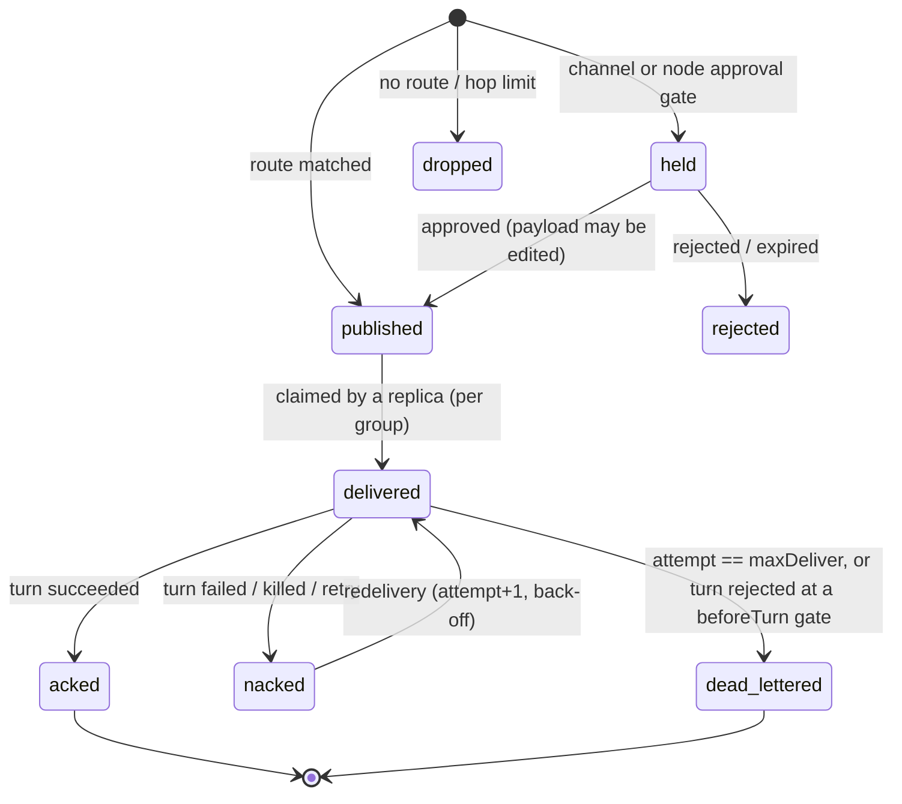

# Events, message lifecycle and traceability

Every fact the platform observes is appended to the **event log** (storage) before it is fanned out
to live subscribers. The log is the audit trail, the source of the console's live view and the
`/api/v1/events/stream` SSE feed, and the thing to read when asking "what happened?" after a restart.
Schema: [`schemas/event.schema.json`](../schemas/event.schema.json); Go: `server/internal/domain/event.go`.

## Envelope

| Field | Notes |
|---|---|
| `seq` | Store-assigned, strictly increasing. Resume cursor (`?after=`, `Last-Event-ID`). |
| `id` | `evt_…`, unique. |
| `type` | See catalogue below. |
| `time` | UTC, RFC 3339. |
| `graphId`, `nodeId` | Scope. |
| `replica` | Always present. `-1` = the node as a whole (node actions, scaling); `0` for graph-level events. |
| `executionId`, `messageId` | Correlation to a turn / message when relevant. |
| `actor` | Authenticated user or token name, `agent:<node>#<n>` / `<graph>/<node>#<n>` for tool calls, `bootstrap…`, or `system`. |
| `traceId` | OpenTelemetry trace id (32 hex) when known — jump to Tempo. |
| `level` | Reserved for log-level events. |
| `data` | Type-specific (below). |

Persisting an event never fails the operation it describes: write errors are logged and dropped.

## Catalogue

| Type | Emitted by / when | `data` |
|---|---|---|
| `graph.created` | engine, first save of a graph | `{version}` |
| `graph.updated` | engine, every later save (also bootstrap reloads that changed the document) | `{version}` |
| `graph.deleted` | engine, `DELETE /graphs/{id}` | — |
| `graph.started` | engine, `start` action | `{action, runId}` |
| `graph.paused` / `graph.resumed` | engine, `pause` / `resume` action | `{action, runId}` |
| `graph.stopping` | engine, `stop` (graceful) or `kill` action | `{action, runId}` |
| `graph.stopped` | engine reconciler, once no replica of a stopped graph is live | `{runId}` |
| `graph.failed` | engine reconciler, when a graph that should run cannot be deployed (version unloadable, condition no longer compiles, broker refuses topology); retried every reconcile, state returns to `running` on success | `{error}` |
| `node.scaled` | engine, `PUT …/scale` on a fixed cluster (`replica: -1`) | `{replicas}` |
| `replica.state_changed` | replica loop, on every state transition | `ReplicaStatus` |
| `execution.started` | turn start | `{iteration, inputs: [messageId]}` |
| `execution.completed` | turn succeeded | `Execution` |
| `execution.failed` | turn failed, cancelled (kill) or interrupted (crash recovery) | `Execution`; for interruptions `{status: "interrupted", error}` |
| `message.published` | engine, after the broker accepted a message on a channel | the full `Message` (`id, type, source, target, payload, metadata`) plus `channel` and `consumers` |
| `message.held` | engine, message parked at an approval gate | `{channel, type, approval}` |
| `message.dropped` | engine, emit matched no channel or exceeded `maxHops` | `{type, reason}` |
| `message.injected` | API, `POST …/channels/{c}/messages` | `{channel, type}` (actor = caller) |
| `message.delivered` / `.acked` / `.nacked` / `.dead_lettered` | *reserved* — these transitions are recorded in **message history** (below), not as events, to keep the log small | — |
| `tool.invoked` | tool gateway, before execution | `{tool, args (≤ 2 KiB), outcome: "started", durationMs: 0}` |
| `tool.completed` | tool gateway, after execution | `{tool, args, outcome: "ok"\|"error", durationMs, error?}` |
| `check.completed` | tool gateway, after a declared check ran through `check.run` (task evidence) | `{check, command, passed, exitCode, timedOut?, infraError?, durationMs, format?, failures?: [{test?, file?, line?, message?}] (≤ 20), failureCount?, truncated?, workspace: {head?, state?, partial?, base?, checkFilesChanged?}}` |
| `tool.denied` | tool gateway: unknown tool, no grant, constraint violation, rate limit, human rejection | `{tool, args, outcome: "unknown"\|"denied"\|"rate_limited"\|"rejected", durationMs, error}` |
| `approval.requested` | HITL service | `Approval` |
| `approval.decided` | HITL service (human decision or timeout) | `Approval` (actor = decider or `system`) |
| `operator.message` | API, `POST …/nodes/{n}/chat` | `OperatorMessage` |
| `agent.output` | runtime narration (native model text, tool call summaries, `POST /output`); live pieces of a native turn's streamed answer (NAT-09) | `{text}` (≤ 8000 chars); a live piece is `{text, stream, partial: true}` (pieces of one `stream` joined in order are the start of the answer, ≤ 8000 bytes in all, at most one per second), and the final output of that answer is `{text, stream}` |
| `agent.context` | a native turn elided older tool results or compacted its conversation (NAT-02) | `{operation: elide\|compact, outcome: ok\|failed, messages, tokensBefore, tokensAfter, window, error?}` |
| `agent.plan` | a native agent replaced its working plan with `plan.update` (NAT-06); the Activity view shows the `in_progress` step of an execution's latest plan | `{items: [{step, status: pending\|in_progress\|done}]}` |
| `agent.broadcast` | ring clusters, end of each turn | `{text, iteration}` |
| `log` | engine: replica completed (stop policy met / ran once), node actions | `{message, node?}` |
| `provider.changed` | provider settings: create, update, delete, default (no graph id) | `{action, provider, revision}` (actor = caller) — never credentials |
| `scm.branch_pushed` | `git.push` succeeded (task graph, node, execution) | `{connection, repository, branch}` |
| `scm.pull_request_opened` | `scm.pull_request.create` opened or found the branch's pull request | `{connection, repository, number, url, head, base, created}` |
| `trigger.note` | something a person should know about a trigger's task (missing Jira transition, failed comment) | `{trigger, task, message}` (graph id = the task run) |
| `trigger.run` | one trigger run (no graph id) | `{trigger, outcome, error?}` |
| `trigger.changed` | trigger created, updated, paused, resumed or deleted (no graph id) | `{trigger, action, state, workflow}` (actor = caller or `system:trigger`) |
| `scm.connection_changed` | SCM connection created, updated or deleted (no graph id) | `{action, connection}` (actor = caller) — never tokens |
| `cost.recorded` | LLM gateway, after every dispatched model call; runtime turn for `TurnResult.usage` (graph, node and execution ids) | `{source: "gateway"\|"external", provider, type, model, execution, usage, estimated, priced, rateSource: "catalogue"\|"local"\|"unpriced", priceVersion, costMicros, currency, error?}` — never prompts, completions or credentials |
| `budget.warning` | first reservation that takes a budget past its warning level | budget view (graph id = task run) |
| `budget.reached` | first call refused by a budget (the run is paused) | budget view |
| `budget.raised` | `POST …/cost/budgets/{scope}/{budget}/raise` | `{scope, id, previousMicros, limitMicros}` (actor = person) |
| `budget.changed` | `PUT /api/v1/cost/policy`, `PUT /api/v1/cost/budgets` | `{scope: "policy", taskRunBudgetMicros, warningPercent}` or `{scope: "definitions", budgets}` |
| `budget.reservation_failed` | an unpriced call refused by the price policy under a budget | `{scope, id, reason, provider, model}` |
| `cost.prices_changed` | `PUT /api/v1/cost/prices` (no graph id) | `{version, currency, prices, unpriced}` (actor = caller) |
| `provider.tested` | provider connection test (no graph id) | `{provider, ok, draft, model, durationMs, error?, toolCalling?}`; `level` is `warn` on failure; errors are redacted |
| `environment.build_started` | `POST …/environment/build` | `{hash, force}` (actor = caller) |
| `environment.ready` | environment build finished | `{hash, image, durationMs}` |
| `environment.failed` | environment build failed, timed out or was cancelled | `{hash, durationMs, error}` |
| `environment.reset` | `POST …/environment/reset`, graph deletion | `{errors}` (number of cleanup steps that failed) |
| `checkpoint.created` | engine, before the first workspace change of a round when the replica's files differ from its newest checkpoint ([checkpoints](native-coding-runtime.md#checkpoints-nat-07)) | `{checkpoint, ref, commit, reason: "before_edit", tool}` (actor = `agent:<node>#<n>`, execution id) |
| `checkpoint.restored` | `POST …/checkpoints/restore` or the agent's `checkpoint.restore` | `{checkpoint, saved, written, removed, source: "api"\|"agent"}` (actor = person or agent) |
| `checkpoint.failed` | recording or restoring a checkpoint failed (the edit still runs; a failed restore may be partial) | `{operation: "record"\|"restore", reason?, tool?, checkpoint?, source?, saved?, written?, removed?, error}` |

`stop` and `kill` emit `graph.stopping` immediately; `graph.stopped` follows when the last replica
has drained.

## Message lifecycle (message history)

Message history is a separate table (`messages`): **one row per (message id, channel, consumer
group)**, updated in place. Publish-side rows have an empty group; consumer rows carry the group and
the attempt counter. Dropped messages are recorded under the pseudo-channel `_unrouted`.



| Status | Row | Meaning |
|---|---|---|
| `published` | group `""` | Accepted by the broker for every group of the channel |
| `held` | group `""` | Waiting for a human at a gate (`metadata.held_for` = approval id) |
| `rejected` | group `""` | Gate rejected or expired |
| `dropped` | channel `_unrouted` | No channel matched, or hop limit; `error` says why |
| `delivered` | per group | Claimed by a turn (`consumer` = execution id, `attempt`) |
| `acked` | per group | Processed; duplicates of it are acked and skipped |
| `nacked` | per group | Failed; will be redelivered |
| `dead_lettered` | per group | Given up; inspect `error` |

## Correlation, causation and tracing

| Mechanism | Where | Semantics |
|---|---|---|
| `metadata.correlation_id` | every message | Id of the first message of the workflow (an injected request); inherited by every descendant. Query: `GET /graphs/{id}/messages?correlationId=…`. |
| `metadata.causation_id` | derived messages | Id of the input message whose turn emitted this one (the turn's *first* input when batching). Rebuild the causal tree from it. |
| `metadata.hops` | every message | Parent hops + 1. Over `spec.maxHops` (default 64) → `dropped` (cycle guard). |
| `metadata.execution_id` | derived messages | The turn that emitted it → `GET /executions/{id}` and `execution.*` events. |
| `metadata.traceparent` | every message | W3C trace context. The `agent.turn` span continues the trace of its first input and **links** the others (fan-in). Tool (`tool.<name>`), LLM (`llm.chat`, `gen_ai.*` attributes) and API spans nest inside; external runtimes receive `traceparent` on `/v1/turn`. |
| `Event.traceId`, `Execution.traceId` | log / executions | Jump from the console or Loki to the trace in Tempo. |

One injected request therefore yields one trace spanning every agent, broker hop, tool call and
model call it caused — across processes and brokers — and one correlation id that selects all of
its messages in history.

## Instruction events

`instruction.skill.updated` carries `skill_id`, `revision`, `deleted` and the authenticated actor. The atomic skill revision retains the durable audit. `execution.instructions.loaded` carries `entries` and `remaining_budget` with graph/node/execution correlation; bodies are excluded. See [instruction audit](instructions.md).

The loaded event also includes `omitted`. The turn span records
`weft.instructions.entries` and `weft.instructions.omitted`. Metrics
`weft_instruction_loads_total{outcome="loaded|failed"}` and
`weft_instruction_load_duration_seconds` cover resolution plus persistence;
labels contain no skill IDs, paths or content.

## Application review events

`review.requested`, `review.session`, `review.session_failed`,
`review.session_stopped`, `review.restarted`, `review.expired`, `review.cancelled`,
`review.decided`, `review.access_revoked`, and `review.continuation_queued` carry
`{id, state, session, generation}`, with graph/node/replica/execution correlation.
The durable record carries the decision actor, timestamp, method and feedback.
Event payloads do not contain preview credentials or HTTP request bodies.

Metrics: `weft_review_transitions_total{action}`,
`weft_preview_access_total{outcome}`, and
`weft_preview_request_duration_seconds`; labels use bounded outcomes/actions,
not review IDs. Reconciliation creates a `review.reconcile` trace span. Cleanup
failures are logged with the review ID and retried while accounting is retained.

### Workspace observations

`workspace.observed` is emitted by the tool gateway after filesystem mutations,
Git writes and shell calls, including failures/cancellation. Its envelope carries
`graphId`, `nodeId`, `replica`, `executionId`, actor and trace identity. Data:

```json
{
  "tool": "shell.exec",
  "status": "complete",
  "attribution": "observed_during_tool",
  "scope": "workspace_except_git_metadata",
  "changes": [{"path": "src/result.txt", "operation": "modified"}]
}
```

Operations are `created`, `modified` or `deleted`; capture status is `complete`
or `partial`. Empty observations are retained. Paths are relative and no file
contents or hashes are stored. Query using the existing graph events API with
`types=workspace.observed`; pagination uses the existing sequence cursor.
See [workspace write access and observations](tool-permissions.md#workspace-write-access-and-observations)
for capture limits, concurrent writers and the distinction from proven authorship.

The continuous monitor uses the same `workspace.observed` type with
`source: "monitor"`, `attribution: "unknown"`, `observedAt`, and `since` when a
previous scan exists. It never supplies an execution ID. Node/replica, when
present, identifies a worktree scope, not the writer. `status: "baseline"` marks
initialization; `gap: true` marks baseline/restart or incomplete coverage.
Discovery failure emits `status: "partial"`, `gap: true` and
`reason: "discovery_failed"` for known scopes. Existing events survive restart,
but snapshot baselines are in memory and offline changes are not reconstructed.
Tool and monitor observations may overlap; neither proves exclusive authorship.

Kernel journal imports use `source: "kernel-journal"`, `journalId`, and
`process: {pid, start, namespace, bootId}`. `attribution: "kernel_pid"` indicates
a positive kernel-reported PID, not an inferred agent/execution; missing process
start time means its lifetime could not be verified. PID 0 uses `unknown`.
Operations also include `moved_from` and `moved_to`. `collector_started`,
`kernel_queue_overflow` and `unresolved_kernel_path` produce partial gap events.
Stable event IDs and durable per-journal cursors prevent duplicate history on
replay; events retain the collector's observation time. Journal metadata contains
no command lines or file contents. See the
[kernel journal contract](tool-permissions.md#kernel-journal-in-the-dedicated-linux-daemon)
for supported namespaces, limits and the meaning of controller-offline recovery.

## Native analysis delegation

See [delegation](delegation.md) for the explicit grant, configurable approval, child
execution records, event metadata, bounded configurable limits and inclusive usage accounting.

Delegation configuration adds `delegation.policy.updated` (revision, enabled,
approvalMode) and `delegation.profile.updated` (profileId, revision, enabled), with
the administrator actor. No profile instructions or objective text is included.
Execution records carry the pinned policy/profile snapshot separately.


`execution.cancel_requested` records the immutable target executionId,
rootExecutionId, scope (`child` or `tree`), actor and requestedAt. It is emitted
once for a newly persisted request, with normal graph/node/execution correlation.
It does not claim the worker has stopped; consult terminal execution records.
Event-bus publication remains best effort; the persisted cancellation setting is
authoritative. Payloads contain no objectives, model output or credentials.

## Public repository imports

`repository.import_transition` records attempted durable transitions with `importId`,
`attempt`, `state`, `bytes` and the selected `authentication` mode (never credentials), plus the initiating actor. It is written before the
compare-and-swap setting update, so an audit entry alone does not prove the update
committed; the import record is authoritative. URLs, Git output and credentials are
not event payloads. `repository.import` spans worker operations.
`weft_repository_imports_total{outcome}` uses bounded outcomes `ready`, `failed`,
`cancelled` and `uncertain`; `weft_repository_import_duration_seconds` records
worker duration. No repository/attempt IDs are metric labels.
