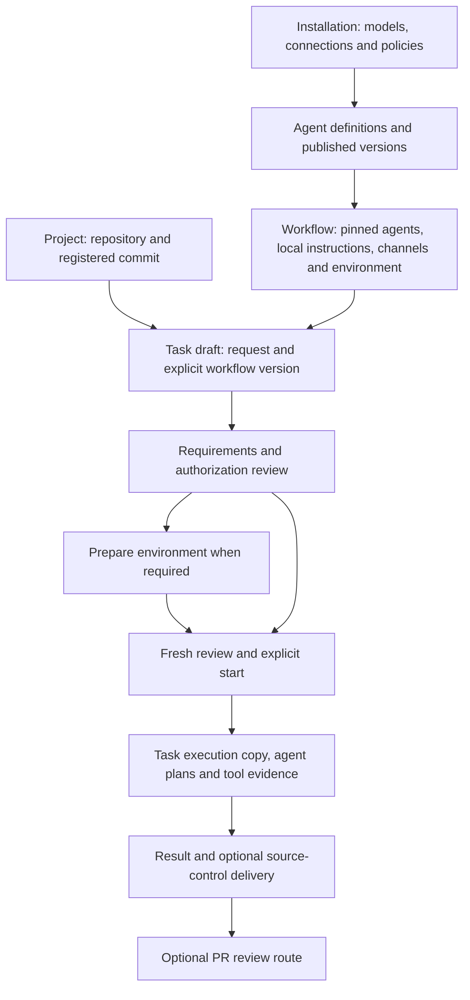

# Feature flow inventory

This directory describes the console and API journeys first inspected at source
baseline `a1668c1` on 2026-11-25, then updated for the approved guided operator
journeys refactoring. It is a reference for finding the
whole flow without opening the application. UI labels are written as displayed.
It records current behavior, including manual handoffs; it does not propose a
new experience or replace acceptance criteria in [specs](../../specs/README.md).

The inventory comes from source inspection and existing tests. No new user
tasks, provider calls, approvals or external writes were performed for this
audit. Screenshots supplied by the operator establish reported friction, not
measurements of completion time or usability. Follow the linked owning guides
for protocol details and qualification limits.

## Journeys

| Feature | Complete flow |
| --- | --- |
| [Chat](chat/README.md) | Inspect or follow an existing task, switch conversations and return to its retained result |
| [Tasks](tasks/README.md) | Describe work, select a version and repository, review access, prepare, start, inspect evidence, deliver and retain history |
| [Setup and readiness](setup-and-readiness/README.md) | Read configuration facts, follow goal guidance, save before repairing dependencies and return to the saved task |
| [Agents](agents/README.md) | Create or discover a reusable agent, publish a version, bind it to workflows and configure local behavior |
| [Workflows](workflows/README.md) | Create a definition, assemble agents and channels, review/save a version and control execution |
| [Projects](projects/README.md) | Register or import a repository, pin its commit and choose it for a task |
| [Connections](connections/README.md) | Configure MCP, source control and issue integrations; test, grant access and recover failures |
| [Models and costs](models/README.md) | Enable a plugin, add a provider, test it and configure prices and spending limits |
| [Environments](environments/README.md) | Define a toolchain, review networking, build it and admit task commands |
| [Approvals](approvals/README.md) | Find a pending decision, inspect its scope, decide and inspect the recorded outcome |
| [Skills and instructions](skills-and-instructions/README.md) | Author reusable guidance, associate it and inspect the instructions used by an execution |
| [Administration](administration/README.md) | Inspect health and manage network, resources, blocked-access retention, tools and delegation |
| [Issue triggers and review routes](issue-triggers-and-review-routes/README.md) | Select issues, assess readiness, create tasks, synchronize lifecycle and dispatch PR review |
| [Activity and runs](activity-and-runs/README.md) | Find current work and inspect executions, messages, events and files |

## How the parts connect

Direct workflow execution is another path: **Start / Run all** operates a saved
workflow. It does not create the task request/review journey above. An issue
trigger can create tasks using previously reviewed trigger consent. Neither
path makes an agent's summary proof that its checks or delivery succeeded.

## Configuration ownership and persistence

| Scope | Examples | When it takes effect |
| --- | --- | --- |
| Installation | Providers, connections, budgets, network policy, skill catalogue | Explicit resource save; individual contracts determine effects on existing work |
| Agent version | Shared instructions, model, tools, parameter declarations | Publish creates an immutable version; workflows must explicitly adopt it |
| Workflow version | Agent bindings/values, local instructions, channels, execution settings and task defaults | Save graph; a browser draft is not the running definition; task defaults are suggestions only |
| Task revision | Request, workflow/version, repository commit, delivery and execution choices | Save draft; reviewed authorization must match the saved configuration |
| Execution | Task-owned graph, instructions, plans, tool outcomes, delivery records | Recorded as work proceeds; retained separately from editable templates |

Navigation alone does not save a form. Not all editors have the same dirty-state
guard; the feature pages below identify relevant differences. Trigger and
connection saves are independent of **Save graph**.

## Roles

The HTTP API enforces permissions even when a control is hidden or disabled.
Roles are cumulative: administrator includes operator and viewer access.

| Role | Main responsibilities in these flows |
| --- | --- |
| Viewer | Inspect ordinary configuration, tasks and execution evidence |
| Operator | Save/interpret task requests, delete eligible drafts with confirmation, control saved workflows and decide ordinary approvals |
| Administrator | Publish agents/workflows, manage integrations/policies, authorize/start/prepare tasks and perform reviewed cleanup |

Some operational views and actions have narrower rules; see each feature and
the routes in [the API server](../../server/internal/api/server.go) and
[OpenAPI](../../api/openapi.yaml). A UI action is not permission to perform an
unrelated external or destructive action.

## Manual decisions and handoffs found in this audit

| Observed implementation | Where the operator encounters it |
| --- | --- |
| New workflows offer a visual builder plus advanced YAML/JSON, with review before saving | Dedicated workflow creation page, then canvas and settings |
| Publishing an agent and adopting its version are separate saves | Agent detail, then workflow binding and graph save |
| Inline workflow agents are registered in the catalogue without automatically converting the origin node into a binding | Agent catalogue and workflow configuration |
| Repository registration, SCM delivery and issue integration are separate resources | Projects, Connections, then task setup |
| Review task saves the exact edits then reviews the saved revision, while interpretation remains optional | Review task, Resolve request, visible setup cards and readiness summary |
| Task entry carries a selected project/workflow, and configuration repair saves first and offers return navigation | Projects/workflows task links, task editor, Models/Connections return context |
| Saving, authorizing, preparing an environment and starting are distinct transitions | Task draft, access review and Environment & logs |
| A prepared environment does not automatically start an interactively prepared task | Fresh requirements review and explicit start |
| A completed plan, passed check, pushed branch and open PR are separate evidence | Task overview, Changes & checks and delivery result |
| Trigger and PR review-route configuration use different entry points | Workflow trigger settings versus review-route API/YAML |

These are candidates for the next flow review, not conclusions that every
decision should be removed. That review should evaluate which choices can be
reused or suggested while preserving version selection, authorization and
observable failure recovery.

## Maintaining the inventory

Update the relevant journey whenever entry points, defaults, save boundaries,
permissions or recovery change. Keep descriptions in English. Link the actual
component/manager rather than copying implementation code. Record new product
intent in `specs/`; keep this directory about implemented behavior.
