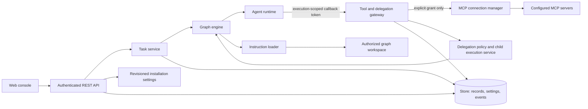

# Product Contracts and Current-State Inventory

This document records the current cross-component baseline and proposed
design contracts for the next Weft capabilities. It is a design reference,
not a claim that planned endpoints or behavior have already been implemented.
The implemented wire contracts remain in [OpenAPI](../api/openapi.yaml),
[Runtime Protocol](runtime-protocol.md), [graph schema](../schemas/graph.schema.json),
[event catalogue](events.md), and [storage reference](database-schema.md).
When implementation begins, update those normative specifications and their
schemas alongside the code.

## 1. Current-State Inventory

| Surface | Current contract and implementation | Known boundary |
|---|---|---|
| Public API | `/api/v1` REST API, role-checked per route; graph CRUD/versioning, lifecycle, messages, chat, executions, events, approvals, model providers, tools, workspace file listing/reading and Git inspection. See [API reference](api.md) and [OpenAPI](../api/openapi.yaml). | Skills/steering and MCP registration/discovery are implemented (see section 3). Prompt-first tasks, reviewed task-owned execution copies, [task authorization](task-authorization.md), bounded native-child recursion, analysis profiles and configurable delegation approval/limits are implemented (see section 4). |
| Web console | React/TypeScript SPA served by `weftd`; graph canvas, provider/integration settings, files, approvals, managed Docker reviews/previews, events, and operational views. Main surfaces: `web/src/App.tsx`, `GraphCanvas.tsx`, `IntegrationsView.tsx`, `FilesView.tsx`, `ApprovalsView.tsx`, and `EventsView.tsx`. | The canvas edits a local graph draft (agents, channels, properties, positions) shared with the YAML view and saves it through the whole-document `PUT` with `If-Match`; validation errors are mapped to the agent/channel field that caused them. File interaction is partial; user file operations are read-only. |
| Runtime | External runtimes use Runtime Protocol v1. `TurnInput` carries graph/node/replica context, prompt, inputs, model reference, granted tools, and a per-execution callback token. Model calls and tools are mediated by the control plane. | Effective instruction snapshots are sent and persisted; native analysis children are implemented for native and external parents through authenticated callbacks; external child runtimes remain planned. Platform-managed provider credentials are not sent to runtimes; graph-authored `runtime.env` and `config` are passed as runtime inputs and are not a secure secret store. |
| Tools and permissions | Default-deny tool gateway. Graph node `tools` grants are enforced for native and external agents; constraints and approval/rate limits are defined in [tool permissions](tool-permissions.md). | MCP registration/discovery and gateway invocation enforce exact grants and current connection state; see [MCP limits](mcp.md). |
| Workspace | `GET /api/v1/graphs/{id}/files` and `/files/content` are viewer-readable. Paths are resolved inside the graph/worktree root; `.git` is hidden, directory results are capped, file content is limited to 4 MiB and served as plain text with a deny-all CSP. | Viewer-readable `/git/status`, `/git/diff` and `/git/history` now provide bounded live inspection with private Git metadata and explicit unsafe-configuration failures. Execution/tool-operation context and bounded before/after observations of filesystem, Git-write and shell calls are persisted; a controller-lifetime monitor additionally records net changes from concurrent/background/external writers with unknown authorship and explicit coverage gaps. A dedicated-Linux-daemon kernel journal also records process PID evidence and transient events and replays them after controller downtime. Exact agent/execution attribution is not inferred; unsupported namespaces, collector downtime, overflow and unresolved paths remain gaps. Native `workspace.readOnly` denies mutation tools, shell and agent Git tools regardless of grants; Docker mounts read-only. External runtimes cannot claim this policy. See [tool permissions](tool-permissions.md#workspace-write-access-and-observations). No user-facing workspace write/delete/upload API. |
| Persistence | `storage.Store` persists graph versions/control records, events, messages, executions, approvals, operator messages, replica status, KV, leases, and revisioned installation settings. Settings use compare-and-set revisions. Provider credentials are encrypted before storage. See [database schema](database-schema.md). | Future install-wide records should use settings or an explicitly designed store entity; graph/workspace data must remain scoped. |
| Authorization | Current installation uses hierarchical `viewer < operator < admin` roles from static tokens or optional OIDC. Route middleware authenticates and authorizes before handlers. Per-execution callback tokens are scoped to one running turn. | There is no multi-tenant/user ownership model. A deployment is one installation security boundary; do not imply per-user data isolation that does not exist. |
| Events and audit | Durable event envelope carries sequence, actor, graph/node/replica, execution/message IDs, trace ID and type-specific data. Provider changes/tests are installation-level events; tool and approval events are already defined. See [events](events.md). | Event append is currently best-effort for some operations. Planned security-sensitive mutations must not silently succeed without their required audit record. |
| Docker deployment | Compose runs `weftd`, the agent runtime, broker, PostgreSQL, observability services, and `sandbox-daemon` (a Docker daemon dedicated to agent command sandboxes, reached over mutual TLS on a separate `sandbox` network; see [sandbox-runtime.md](sandbox-runtime.md)), with named data volumes. The web console is accessed through the published `weftd` port. | Future MCP transports must be reachable from the platform container under explicit network policy; arbitrary local process launches in `weftd` are not permitted. |

The current model-provider management API is the established pattern for
installation-managed configuration: metadata-only reads, write-only
credentials, `If-Match` revision checks, role-specific operations, and
redacted test results. New installation-managed resources should follow that
pattern where applicable.

Durable Docker review/preview contracts are implemented separately from ordinary
approvals; see [review API](api.md#durable-application-reviews),
[tool yield/continuation](runtime-protocol.md#yielding-for-durable-human-review)
and [gateway operations](sandbox-runtime.md#human-review-and-application-previews).

## 2. Contract Conventions

- JSON field names are `camelCase`; event metadata keys retain their existing
  `snake_case` convention.
- IDs are opaque, stable identifiers. Clients must not infer authorization
  from an ID or a tool name.
- Installation-managed mutations use revision/ETag compare-and-set and return
  `409 conflict` for a stale revision or an incompatible state transition.
- Invalid request fields return `422 invalid` with field paths in
  `details.errors[]`. Malformed JSON returns `400 invalid`.
- `401 unauthorized`, `403 forbidden`, `404 not_found`, and `429 rate_limited`
  retain their existing meanings. Upstream MCP/provider failures use a
  non-success HTTP status when the operation itself fails; a successful test
  request may return `200` with `ok: false` to report the test result.
- Error text, events, logs, and response bodies must not include secret
  values. Do not echo request bodies that can contain credentials.
- Platform-managed provider, MCP, and control-plane credentials are never sent
  to an agent runtime. Graph-authored `runtime.env` and `config` are separate,
  user-controlled runtime inputs; they must not be used for managed secrets.
  A future secret-reference feature must resolve credentials only at the
  control-plane boundary and must not serialize their values into `TurnInput`.
- Every persisted mutation that starts work or changes permissions/configuration
  records the authenticated actor and its relevant scope. Audit payloads must
  omit credentials and redact sensitive tool arguments/results.
- Authorization is enforced in the control plane for every request/call. Data
  is scoped to the installation and, where applicable, graph, node, workspace,
  task, and execution. Agent-provided IDs, prompts, skills, or steering never
  grant authority.

## 3. Installation-Managed Connections and Skills

### MCP connections

An installation can configure multiple connections for one MCP service. The
[MCP guide](mcp.md) covers the connection lifecycle and tool authorization.

| Method and path | Minimum role | Contract |
|---|---|---|
| `GET /api/v1/mcp/history` | viewer | Filter persisted tool/approval metadata and safe outcomes; bounded scan and exclusive sequence pagination. No raw arguments/results/comments. |
| `GET /api/v1/mcp/connections` | viewer | List connection metadata and current status; never return credentials or ciphertext. |
| `POST /api/v1/mcp/connections` | admin | Create a connection; credential fields are write-only. Return `201` and the safe connection view. |
| `GET /api/v1/mcp/connections/{connectionId}` | viewer | Read the safe connection view. |
| `PUT /api/v1/mcp/connections/{connectionId}` | admin | Update settings/credential with `If-Match`; omitted credential keeps the stored value, explicit clear removes it. |
| `DELETE /api/v1/mcp/connections/{connectionId}` | admin | Remove a disabled connection after OAuth revocation, with current `If-Match`; return `204`. Retain a minimal reserved-ID tombstone and audit history. Old grants remain in graph documents but fail closed. No remote registration deletion. |
| `POST /api/v1/mcp/connections/{connectionId}/test` | operator | Test reachability/authentication and report a redacted result. |
| `POST /api/v1/mcp/connections/{connectionId}/tools/refresh` | operator | Discover and persist the current tool catalogue; return the new catalogue revision. |

Connection metadata includes `id`, `service`, display name, endpoint and transport
metadata, `status`, `credentialConfigured`, `lastTest`, `toolsRevision`,
`createdAt`, `updatedAt`, `updatedBy`, and `callsPerMinute`. See the
[quota rules](mcp.md#connection-quotas-and-call-history) for `callsPerMinute`.
Read models exclude credential values, authorization headers, refresh tokens and
ciphertext. The installation secret key encrypts secrets before storage. Each
connection has its own revisioned setting, `mcp/connections/{connectionId}`, so
updates to different connections are independent.

**Implemented invocation contract:** The platform owns MCP transport sessions. Agent runtimes never receive MCP
credentials or connect directly to MCP servers. Discovered tools are exposed
only through the tool gateway under a stable connection-qualified name
`mcp.{connectionId}.{toolName}`. A node must have an explicit matching grant
in `spec.nodes[].tools`; existing constraints, rate limits, approvals, and
gateway checks apply to every invocation. Removing a connection invalidates
its grants and makes further calls fail closed. Already dispatched operations cannot be rolled back.

Transport support is selected from transports reachable by `weftd` inside
Docker and implemented without executing arbitrary user commands in the
control-plane process. Connection-level network restrictions, TLS validation,
timeouts, response-size limits, cancellation, and redirect/endpoint
validation are mandatory. No endpoint or tool name supplied by an agent may
cause the gateway to select a different connection.

### Skills and project steering

Implemented contracts and explicit bounds are documented in [Skills and steering](instructions.md).
The API/schema/runtime references are updated with the implementation.

- Application-managed skills are installation resources with stable IDs,
  immutable revision history, a title/description, an enabled flag, and a
  versioned Markdown body. API: `GET/POST /api/v1/skills`,
  `GET/PUT/DELETE /api/v1/skills/{skillId}`. Reads require `viewer`; writes
  require `admin`; updates/deletion use `If-Match`. `DELETE` disables a skill rather than
  erasing revisions; it returns `409` while a latest or active graph version selects
  that skill. Existing execution manifests remain resolvable.
- Graphs opt into skills by ID through a graph-level instruction reference;
  nodes may narrow the selected set but may not add unapproved privileges.
- The graph field is `spec.instructions: {skillIds: string[],
  projectSteering: boolean, installationDefaults: boolean}`; omission means no application skill or project
  steering is loaded. Nodes may optionally name a subset of the graph's
  selected skill IDs. A node cannot reference a skill that its graph did not
  select. Omitted/null node selection inherits; an explicit empty array selects
  no graph skills. Installation defaults require their own graph opt-in.
- Project steering is read only from the authorized graph workspace under
  `.weft/steering/`, from immediate `*.md` files whose resolved paths remain
  inside that workspace. The graph must explicitly enable project steering.
  Observed symlinks and special files are rejected; rooted reads prevent escape.
- The effective instruction precedence is platform security policy (not
  overrideable) → installation defaults → graph-selected skills → authorized
  project steering → node prompt/instructions → current task. This is
  precedence for context composition only: no instruction source can alter
  authorization, limits, credentials, or approval policy.
- Each execution records an immutable instruction manifest: source type,
  stable ID/path, revision or content hash, and whether content was included
  or omitted due to a size/token limit. The runtime receives the composed
  instruction content and non-secret manifest only. Repository content is
  untrusted input and must be bounded and isolated by workspace.

### Project environments

**Delivered** (see [environments.md](environments.md)):

- `spec.environment` in the graph document is the single effective
  definition: `image` or `dockerfile`, `setup[]`, `network.setup`/`network.run`
  (`none`/`bridge`/`egress`, with separate `network.setupAllowedHosts` and `network.allowedHosts`),
  `caches[]`, `timeout`, `cpu`, `memory`, and optional
  `origin` for accepted repository definitions. It is versioned
  with the graph and saved through the graph `PUT`.
- Build state per graph: `absent`, `building`, `ready`, `failed`, with the hash
  of the built definition, image reference, cache volumes, timestamps, actor and
  a 64 KiB log tail. `upToDate` compares it with the saved definition.
- `GET /graphs/{id}/environment` (viewer), `POST …/environment/build`
  (operator, `{force}`), `POST …/environment/reset` (admin, refused while the
  graph runs). Starting nodes that need an environment that is not up to date
  returns `422` at `spec.environment`.
- Events `environment.build_started|ready|failed|reset`; metrics
  `weft_environment_builds_total{outcome}` and
  `weft_environment_build_duration_seconds{outcome}`; span
  `environment.build`.

**Delivered discovery API:** `GET /graphs/{id}/environment/discovery` (viewer)
reads an existing checkout without mutation. Explicit `spec.environment` returns
`source: interface`, `status: configured`; otherwise discovery follows Weft,
devcontainer, Dockerfile, Compose precedence. Results contain `source`, `status`
(`review_required`, `invalid`, or `proposal_required`) and `candidates` with
`path`, `sha256`, optional `services` and `error`. No source contents are returned.
Discovery performs bounded structural inspection. `POST …/environment/resolve`
(viewer) accepts `{source, path, sha256, service?, target?}`, verifies the selected candidate,
normalizes supported fields and returns an environment with
`origin: {source, path, sha256, service?, files: {path: sha256}, dockerfilePath?, contextSHA256?, target?}` for review.
The console requires explicit selection, review and acceptance into the draft.
Persistence uses the existing **admin-only** graph PUT and optimistic concurrency;
acceptance never starts a build. Source and referenced-file hashes and normalized
settings are checked again on graph save and before build (including cache hits).
Stale files/settings and unsupported fields return `400` without starting Docker;
graph version conflicts retain the existing `409` behavior.

Supported input subsets and limits are documented in [environments.md](environments.md).
Repository definitions cannot set origin, CPU/memory overrides or execution
networking beyond `none`; unhandled Compose settings and unsupported Dockerfile
features fail explicitly. Local COPY/ADD contexts are confined to the workspace,
filtered by ignore rules, bounded, hashed on acceptance, and revalidated before
save and build. The validated tar snapshot is sent to the dedicated daemon.
Named build targets are selectable for standalone Dockerfiles and supported via
Weft `target` and Compose `build.target`. The accepted target contributes to
the image hash. COPY --from supports local stage names/indices with cycle
validation and syntactically validated external image names, tags and digests.
Local stages take precedence; unmatched names resolve as images during build.
Acceptance tracks literal references, not mutable registry tag contents. External
named build contexts and other COPY flags remain unsupported. These are conservative input restrictions, not a
new installation-wide policy configuration. Missing/unreadable checkouts or scan
limits return an error, never a fallback. Discovery does not clone a repository.

When discovery returns `proposal_required`, an admin can request a bounded,
tool-free model analysis of allowlisted manifests/lockfiles. A durable
`environment` approval includes the full suggested definition, rationale and
input fingerprint. Admin acceptance revalidates the graph version and input
hashes, saves the exact approved definition and triggers the build. The engine
blocks starts until ready; a graph starts automatically only when the requester
explicitly selected that option. Rejection, expiration and cancellation do not
build. Approved work survives restart, and failed builds can be retried. This
workflow is available through the console and environment proposal API; invoking
it through `environment.propose`/`environment.status` agent tools is implemented
for the own-graph, initially unconfigured environment (see tool contracts).
See [proposal limits and behavior](environments.md#agent-proposal-and-developer-approval).

**Delivered scope and limits:** discovery, initial proposals, prepared-image/cache-seed
reuse, global CPU/memory/count admission, idle suspension and explicit shared
cleanup are implemented. Full Compose/devcontainer compatibility, replacement
proposals with diffs, registry-wide egress controls and exact queue ETAs are
outside this release. See [sandbox acceptance evidence](sandbox-acceptance.md).

<a id="planned-discovery-and-acceptance"></a>
#### Discovery and acceptance

Repositories do not need Weft-specific files. Preserve an explicit
operator-configured environment; otherwise discover definitions in the order
below. Acceptance saves the effective definition into `spec.environment`,
creating a graph version attributed to the accepting operator. Keep the source,
bounded input fingerprints and definition hashes as provenance (not a full Git revision) so changes can be detected
before acceptance and build.

| Priority | Source | Delivered contract |
|---|---|---|
| 1 | `.weft/environment.yaml` | Highest repository priority; same environment fields, with validated repository-relative Dockerfile paths and build contexts confined to the authorized workspace. |
| 2 | `.devcontainer/devcontainer.json` | Support the image/post-create command subset initially; report unsupported fields explicitly. |
| 3 | Dockerfiles | Discover candidates and build targets within bounded repository paths; ask the operator to choose when ambiguous. Validate build context containment and respect ignore rules. |
| 4 | Docker Compose | Discover `compose.yaml`, `compose.yml`, `docker-compose.yaml`, `docker-compose.yml` and explicitly selected variants. Select a development service and review required companion services; do not start the entire stack automatically. Only the documented supported fields and standalone variants are accepted. |
| 5 | Agent analysis | Only when no definition file is found: analyze manifests, lockfiles and toolchain declarations such as `mise.toml`, `go.mod` and `package.json`, then propose an environment for developer approval. |

Show discovered definitions for operator acceptance before building. An invalid
or unsupported higher-priority definition produces an actionable error, not a
silent fallback to another source or agent analysis. Repository content cannot
request host mounts, privileges, credentials, limits or network access beyond
installation policy; acceptance does not bypass those controls. Compose
interpolation and build contexts require the same validation and trust boundary.

The analysis agent must work before a project environment exists, using bounded,
read-only access to the authorized repository without installing dependencies
or executing repository commands. The delivered tools are:

- `environment.propose {image or dockerfile, setup, network, caches, rationale}`:
  propose the tools/image, preparation steps and resource needs; open an approval
  showing the complete definition and rationale. Replacement of an existing environment and diff review remain outside this release.
- `environment.status`: report environment/build state and why work is waiting.

The developer approval gate blocks both building and task execution. Rejection
or cancellation must not start either. Approval saves the accepted definition
as a new graph version with the approver as actor; revalidate its revision and
installation policy before building. Execution resumes only after the environment
is ready. Stale approvals, analysis failures, timeouts and build failures remain
visible with an explicit recovery path. The API and tool contracts are documented
in [environments](environments.md) and [tool permissions](tool-permissions.md).

#### Network policy and egress

The [installation policy](environments.md#installation-environment-policy-implemented)
sets the allowed network modes and the installation host ceiling. Only admins
can preview and save [network policy changes](api.md#installation-network-policy).
Saved network fields override YAML defaults across controllers sharing the store.
Policy checks apply to graph and approval changes, builds including cache hits,
and new runtime admissions. Active containers keep their network settings until
replaced.

[Runtime egress](environments.md#runtime-egress-proxy-and-per-environment-hosts-implemented)
uses a per-replica proxy. [Build and setup egress](environments.md#build-and-setup-egress-proxy-implemented)
uses a separate host list and capacity reservation. Preparation hosts affect
the image reuse key. Runtime hosts affect the execution group. Daemon-wide
registry controls remain planned.

#### Proxy diagnostics

The [proxy diagnostics guide](environments.md#proxy-state-and-blocked-access-in-the-console)
defines the read-only status and sampling rules. Preparation snapshots survive
container cleanup until the next capture or Reset. The separate
[blocked-access history API](api.md#environment-blocked-access-history) reads
shared storage independently of Docker and applies the installation retention
policy. The history covers collected denials and can have sampling gaps.

#### Reuse and resource lifecycle

[Environment reuse](environments.md#reuse-across-tasks) defines compatibility
and invalidation. Tasks keep separate workspaces, active containers and writable
cache copies. Shared image layers exclude task-specific files and secrets.
Reset preserves shared generations. The admin
[cleanup API](environments.md#cleanup-of-unused-shared-generations) rechecks references before removing
unused registered generations. The console explains source selection, approval
and capacity waits, why an image was reused or rebuilt, and what Reset retains.

[Sandbox capacity](sandbox-runtime.md#global-execution-sandbox-capacity) covers
execution and environment preparation. [Idle suspension](sandbox-runtime.md#idle-suspension-and-task-resume)
releases capacity after a confirmed stop and resumes the existing container
after admission. See [acceptance evidence](sandbox-acceptance.md#evidence-map)
for coverage of reuse, cleanup and capacity.

## 4. User Tasks and Child Executions

### User-initiated tasks

Durable task drafts, reviewed task-owned execution copies, registered local
projects/worktrees and contextual progress/approval views are implemented within
the limits in [Task-oriented workflow contracts](task-workflows.md). Tasks reuse
the existing engine, queues, gateway, storage and versioned workflow graphs;
they do not introduce another execution engine or a new user-role hierarchy.
The current implemented API remains [OpenAPI](../api/openapi.yaml).

The [prompt-first workflow](task-workflows.md#prompt-first-tasks-and-authorization-modes--incremental-delivery)
covers the editor, workflow selection, request interpretation and repository
imports. Saving persists a draft. **Run task** requires administrator confirmation
and uses existing admission after server review. Missing inputs stay in the draft
for explicit continuation, and replaying a submission key cannot start another
execution. The separate reviewed start remains available. The task and global
inbox share one approval decision. A policy denial blocks the operation.

[Task authorization](task-authorization.md) defines the implemented modes and
gateway precedence. New tasks default to **Ask for approval** at admission.
**Workspace access** and **Full access** require explicit confirmation of the
reviewed task scope before starting. The gateway enforces installation policy,
agent grants and mandatory approvals in every mode, including for delegated
children. Project preferences are suggestions that require confirmation for each
new task. Active tasks can only reduce automatic authorization, and pending calls
recheck consent. The workflow guide covers the
[mode selection and review](task-workflows.md#authorization-mode-selection).
A risk-based **Approve for me** mode remains deferred.

### Dynamic child execution

**Implemented foundation:** Native and external parents with the exact `delegation.request`
grant can request an installation analysis profile, follow its installation
approval policy and receive the result. Children use the parent's model; the default
analysis profile has no tools or workspace. Profiles may select an exact subset of
parent grants with all constraints preserved, using the parent's workspace and
gateway. Children have no parent conversation history or memory/emit. Further delegation
requires an inherited explicit capability and available configured depth (default one). Execution records, approval context,
bounded shared-store capacity limits and parent links in Runs are implemented.
See [delegation](delegation.md) for the precise contract and limitations.

**Implemented configuration:** Policy GET/PUT and profile list/create/read/update
APIs support native profiles with optional inherited capabilities, required/automatic approval and bounded
limits. The console provides reviewed admin-only saves with revision conflicts.
Execution snapshots pin policy/profile revisions; pending requests revalidate them.
See [delegation](delegation.md) for the supported fields and hard bounds.

**Implemented execution controls:** Runs provides a bounded persisted execution
tree, including historical parent relationships, status, duration and inclusive
usage. Viewer reads and operator/admin interruption use separate API roles.
Child-only cancellation returns an error to the parent; whole-tree cancellation
stops the current root and descendants cooperatively. Confirmation, durable
request state, pending approval cleanup and unchanged graph/grants are covered.
Native child recursion is bounded to the configured depth (1–4), with a shared
root token ledger and recovery. Hard process kills and monetary ceilings are not
implemented. External parents use the active execution callback and native children.

**Planned extended contract (not the current API):** The broader profile fields,
profile deletion, `agent.delegate` name and alternate `/delegations` request
shape below remain proposals. The implemented external-runtime callback is
`POST /tools/delegation.request` with `template` and `objective`, scoped to an
active execution. It does not accept `input` or `idempotencyKey`. Current profiles
are disabled through revisioned updates, not deleted. The tables and examples
until section 5 describe this proposed extension only; use
[delegation](delegation.md) for supported APIs and field names.

The installation administrator manages approved profiles and the global
delegation policy through the public API:

| Method and path | Minimum role | Contract |
|---|---|---|
| `GET /api/v1/delegation-policy` | viewer | Read the effective policy; no secrets are included. |
| `PUT /api/v1/delegation-policy` | admin | Update policy with `If-Match`; validate every configured limit against finite server-side bounds. |
| `GET /api/v1/delegation-profiles` | viewer | List safe profile metadata and revisions. |
| `POST /api/v1/delegation-profiles` | admin | Create an approved profile; return its stable ID and revision. |
| `GET /api/v1/delegation-profiles/{profileId}` | viewer | Read the safe profile definition and allowed grants. |
| `PUT /api/v1/delegation-profiles/{profileId}` | admin | Create a new profile revision with `If-Match`; active delegations retain their pinned revision. |
| `DELETE /api/v1/delegation-profiles/{profileId}` | admin | Disable/remove a profile; refuse with `409` while referenced by active delegations. |

Profiles are installation-scoped templates containing a configured runtime
and model reference, bounded objective/input instructions, and an allowlist of
tool grants. They cannot contain provider/MCP credentials, arbitrary runtime
commands, endpoints, or secrets. The revisioned installation policy contains
`enabled`, `approvalMode` (`required` or `automatic`), `maxDepth`,
`maxChildrenPerExecution`, `maxConcurrentChildren`, `maxDurationSeconds`,
`maxInputTokens`, `maxOutputTokens`, and `maxCumulativeTokens`. These limits
are enforced across all service instances. Settings and profiles use
compare-and-set revisions; each delegation records the effective policy and
profile revision used to authorize it.

Delegation is a runtime capability, not an API that lets an agent mutate the
permanent graph. When enabled by installation policy, the runtime sees a
platform-provided `agent.delegate` tool. It is advertised only when the
delegation service can accept requests; agents cannot enable the capability
or select arbitrary grants themselves.

The callback operation is scoped to the current execution token:

```http
POST /internal/v1/executions/{executionId}/delegations
Authorization: Bearer <current execution callback token>
Content-Type: application/json
```

```json
{
  "profile": "approved-profile-id",
  "objective": "Review the proposed implementation",
  "input": {},
  "idempotencyKey": "caller-generated-key"
}
```

The profile must be an installation-approved agent template. The service
derives effective permissions as the intersection of the parent's grants and
the profile's allowed grants; arbitrary runtime, model, endpoint, credential,
or grant overrides are rejected. The response identifies the delegation and
its state. In approval-required mode, creation returns `awaiting_approval` and
the callback waits for approval/terminal result within the turn deadline. In
automatic mode, the child starts immediately if all limits allow it.

Persist `delegationId`, `parentExecutionId`, root execution/task ID, profile
revision, objective, state, approval ID, child execution ID, effective-grant
hash, timestamps, usage, and terminal result. Child executions carry
`parentExecutionId` and `delegationId`; they never modify the saved graph.
Enforce global maximum depth, children per parent, concurrent children,
duration, and cumulative usage/budget at the service, across all instances.
If token usage cannot be measured reliably for the chosen provider, reject
policies that require token-budget enforcement and do not claim a token or
cost ceiling was enforced. Cost may be reported as unavailable when usage is
reliable but provider pricing is not.

## 5. Authorization, Audit, and Error States

### Authorization matrix for planned operations

| Operation | viewer | operator | admin | Agent/runtime |
|---|---:|---:|---:|---:|
| Read safe MCP/skill/task metadata and task history | yes | yes | yes | no |
| Test an MCP connection or refresh its tool catalogue | no | yes | yes | no |
| Create/update/revoke MCP connections or global skills | no | no | yes | no |
| Start or cancel user tasks, or save task consent | no | no | yes | no |
| Decide ordinary approvals | no | yes | yes | no |
| Decide environment proposals | no | no | yes | no |
| Invoke an MCP tool | no | no | no | only via current execution token and explicit effective grant |
| Request a child execution | no | no | no | only via current execution token, enabled policy, approved profile, and enforced limits |
| Read/write project steering | read-only through its authorized execution context | read-only through its authorized execution context | configure graph access | only content passed for this workspace; no direct host filesystem access |

Role checks are necessary but not sufficient: graph/workspace association,
resource state, node grants, execution-token scope, and policy limits are
checked independently at the operation boundary. The installation remains
the tenant boundary until a separate multi-tenant identity/ownership model is
designed.

### Audit event families

The [event catalogue](events.md) defines the emitted names and payloads for
[installation and task audit](events.md#installation-and-task-audit-events),
[instructions](events.md#instruction-events) and
[delegation](events.md#native-analysis-delegation). MCP tool calls use the
gateway's `tool.*` events. See [MCP call history](mcp.md#connection-quotas-and-call-history)
for the fields exposed to readers.

Use actor, scope and resource IDs, revision, outcome, duration and safe error
codes where applicable. Omit raw credentials, auth headers, full prompts and
unredacted MCP arguments or results. For security-sensitive changes that require
an audit record, persist it before reporting success and surface failures. Tool
telemetry is a guaranteed audit record only when durable append is confirmed.

### User-visible state and error mapping

| Condition | HTTP/API behavior | Interface state |
|---|---|---|
| Invalid field, unsupported transport, malformed instruction, or invalid target | `422 invalid`, with field path(s) in `details.errors[]` | Show the error beside the field/graph element; retain user input. |
| Missing/invalid authentication | `401 unauthorized` | Prompt to sign in; do not clear unrelated unsaved graph edits. |
| Authenticated caller lacks role, graph access, or tool grant | `403 forbidden` | Explain the denied action without exposing secret or protected resource details. |
| Resource or graph does not exist | `404 not_found` | Show unavailable state and preserve the rest of the view. |
| Stale revision, duplicate idempotency key with different payload, invalid lifecycle transition, or resource still in use | `409 conflict` | Preserve local edits and offer refresh/recovery. |
| Rate/cost/concurrency/depth limit reached | `429 rate_limited` or a typed `409 conflict` for a persisted policy cap | Explain which limit blocked work and whether retry is possible. |
| Connection/runtime/provider unavailable or timed out | Typed non-2xx error for the operation; test endpoints may return `200` with `ok: false` | Show `unavailable`/`timed_out`, safe diagnostic, retry action, and last successful check separately. |
| Human decision required | Accepted work remains `awaiting_approval`; no child side effect before approval | Show pending approval and the task/delegation context; decisions are first-writer-wins. |
| Cancellation requested | Accepted work enters `cancel_requested` until termination is confirmed | Show that cancellation is in progress; only report `cancelled` after termination. |
| Unexpected internal failure | `500 internal` with generic public message and correlation/trace ID | Show an error state and trace/reference ID; never a success-shaped fallback. |

All operations must have finite deadlines and payload limits. An error or
timeout must not silently fall back to broader permissions, a different
connection/provider, omitted security policy, or a successful state.

## 6. Planned Component Boundaries

The following view describes the target boundaries for Release 1 additions.
See the [specification index](../specs/README.md) for implementation status.



The public REST API does not proxy arbitrary MCP endpoints or expose callback
tokens. The runtime callback remains per-execution and short-lived. The
connection manager owns external sessions and credentials; the delegation
service owns policy, profile selection, approvals, resource budgets, and child
execution lifecycle. The instruction loader can read only the graph's
authorized workspace and returns content plus a provenance manifest.

## 7. Acceptance Criteria for Contract Readiness

- Backend, UI, runtime, and operations can use this document to agree on
  resource boundaries and failure behavior before implementing each feature.
- Implementations update OpenAPI, JSON Schemas, domain types, migrations when
  required, event catalogues, and user/operator documentation together.
- Contract tests cover authorization failures, stale revisions, secret
  redaction, workspace isolation, approval gates, idempotency, limits, and
  cancellation.
- No planned behavior is described in product UI or setup documentation as
  available until the corresponding implementation and tests pass.

### Environment progress in the console

Implemented: graph environment settings and the agent panel explain reuse,
build-reason categories, active build phases and capacity waits. The agent panel
respects inherited isolation and image overrides, shows environment readiness
and errors, and presents recent per-replica admission history. Structured status
is persisted independently of build logs. Exact changed-file diffs, durable
execution queue positions/ETAs remain outside this release. Browser E2E includes
both deterministic Docker fixtures and a real dedicated-daemon journey.

### Reviewed Compose dependency groups

Implemented: standard Compose filenames and explicit standalone variants,
development service selection, transitive list-form dependencies and mandatory
helper review in the console. Up to three prebuilt helpers run only during agent
execution, each replica in its own internal network. CPU/memory/count admission
is atomic for the entire group; suspension preserves helper data, and explicit
teardown removes only owned containers/network/helper anonymous volumes. Source
fingerprints and role-based graph saving remain authoritative.

Unsupported: implicit override merging, helper builds, environment/secret injection,
mounts, ports, privileges, network overrides, application-health conditions and
helper availability during build/setup. Rejection is explicit; unrelated services
never start. See [Compose services](environments.md#compose-runtime-services).

### Delivered agent environment tools

`environment.status` and `environment.propose` are grant-controlled, own-graph
operations for native/external agents through the same gateway. Proposing requires
a Docker node without its own image override and no accepted/repository environment.
The complete definition remains untrusted: installation policy and repository
fingerprints are checked, and administrator approval is mandatory. The tool waits
for approval and build readiness; the executor switches the sandbox while retaining
the workspace before commands continue. Pending/failed proposal gates block ordinary
tool calls. Rejection/expiration/stale inputs/build or sandbox failures remain
visible errors. Pending approval is cancelled on caller timeout where possible;
approved durable work may finish after a turn ends. Restart continuation uses
existing queue/execution retry semantics. See the environment/tool documentation.

### Task activity in the console

**Implemented:** Each graph has an Activity tab aggregating the existing authorized
status, executions, messages, approvals, reviews and events APIs. It shows current
replica state/detail separately from historical executions and their recorded
summaries/errors. Selecting an execution restricts events and approvals by its
execution ID and messages by input/output IDs or emitting execution metadata;
sharing an agent does not establish causality. Reviews remain graph-wide.

The view refreshes on events and every five seconds, with manual retry and explicit
per-source errors. Failed sections are not shown as an empty successful response.
It displays at most 100 recent executions, 100 recent messages and 300 recent
events; it does not claim complete history, a new persisted task entity, or a work
completion percentage. Operators/admins use existing approval actions; environment
approval remains admin-only. Viewers have no decision controls. Server authorization
continues to apply to every read and mutation. Workspace inspection remains read-only.

### Gateway delegation tree token admission — implemented

A native or external parent explicitly granted `delegation.request` shares a persistent token
ledger with its analysis children. Administration configures `maxTreeTokens`;
the tighter parent limit applies. Reservation precedes dispatch and child approval.
Settlement is idempotent per model call and never sums inclusive execution totals.
Pre-dispatch failure/cancellation releases the reservation; unknown post-dispatch
usage becomes an estimated charge, and storage failures cannot replenish budget.
Runs exposes charges, reservations and estimates under existing read permissions.
Terminal-root recovery releases undispatched holds and estimates unknown dispatched
usage, without modifying active trees. After 30 days, terminal per-call detail is
compacted into a durable closed summary preserving totals and blocking late calls.
This does not establish a provider billing guarantee, unconditional crash refunds,
accounting for runtime-local inference outside the gateway or a monetary ceiling. See [delegation](delegation.md#cumulative-tree-token-budget).
