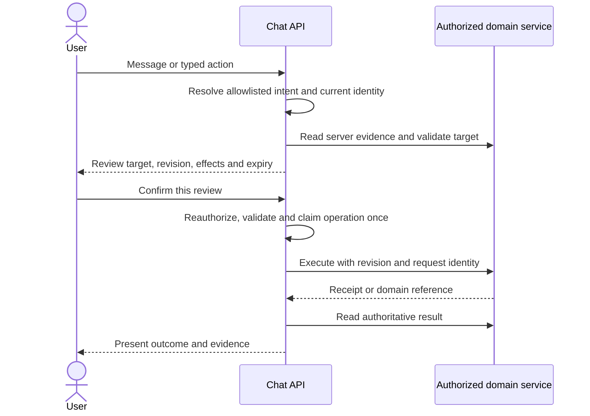
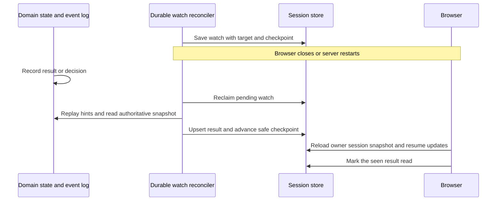

# Conversational Console

An operator can describe an objective, discover existing configuration, review
or execute an authorized operation, and return to the same conversation for
the observed result. The conversation connects setup, reusable agents and
workflows, tasks, controls, decisions and evidence. The manual console remains
available for each enabled capability, including operation without a model.

[The behavior and oracle matrix](./matrix.md#behavior-and-oracle-matrix) defines
the scenarios. The [operation inventory](./matrix.md#operation-inventory) and
[impact review](./matrix.md#impact-review) record checkout findings and delivery
work. The route names, data boundaries and phase design below are proposed ahead
of implementation. The interface review uses the supplied visual direction,
source, guides and regression tests. Browser interaction and assistive
technology verification belong to the delivery phases. TASK-012 owns each AC
identifier in this document.

## Maintainer decisions

- The user should be able to complete every operation available to their role
  in the Weft console from the conversation. The manual console is an optional
  preference. AC-011 defines completion and how to account for steps that
  currently require another Weft screen.

- Chat becomes the home screen and first entry in the left menu. Existing
  destinations remain below it. The conversation sits in the center and a right
  panel starts with **New chat**, then **Recents**. There is one list without
  project grouping. Each operation identifies its own target.
- The assistant derives the title from the request. The row truncates it.
  The full title and details are available by pointer, keyboard and touch.
  Console density and details on demand follow the supplied visual reference.
- Users can archive, find and restore conversations. There is no conversation
  deletion control or public user deletion API. Technical retention and backup
  have a separate policy decision.
- Replies can include typed actions and read-only inspection links. Returning
  from inspection restores the session context. An equivalent text request
  takes the same authorization, validation and confirmation path.
- Execution and monitoring have an animated status. A green dot signals an
  unread successful result. Failure, cancellation and decision-required states
  have accessible labels. Opening a session grants no approval.
- In authenticated installations, history belongs to the owning principal.
  In auth-disabled local installations, the history is shared and Chat visibly
  labels it **Shared local history**. Existing manual paths remain available.
- An administrator selects a provider already configured in Weft and names
  the model for Chat explicitly. Inference for interpretation and titles is
  accounted for. The selection does not inherit the workflow default.
- Active and archived conversations are retained without automatic expiration.
  Backup qualification and restore operations retain their separate controls.

## Behavior and invariants

### Navigation and session presentation

Propose `#/chat`, `#/chat/<sessionId>` and `#/chat/archived` as canonical
routes. An empty hash (including a bare hash) opens Chat after authentication.
A recognized manual route keeps its canonical behavior, including local
subroute fallbacks. An unknown top-level route or malformed escaped ID offers
an unavailable-route view with safe links to Chat and manual navigation.
An absent or inaccessible session has the same unavailable response. No
fallback creates a durable session. **New chat** opens an empty composer. The
first accepted message creates the record once using a client request key.
Distinguish loading, no sessions, refresh, offline and unavailable results.
Keep the last authorized view legible with its observation time while
reconnecting. Keep unsent input local to its owner and tab, including return
from manual setup. Clearly mark whether a message was durably accepted. Retry
a response of uncertain delivery with the original key.

Retain `#/graphs`, `#/g/<id>/...`, task entry/review queries, task-owned
execution links, explicit Connections routes and the `#/integrations` alias.
The server OAuth callback and both SPA return aliases must be handled before
fallback. An optional return to a chat is an authenticated, same-origin reference
associated with the setup transaction, separate from the OAuth state/code.
Keep the existing callback errors and sanitized URL cleanup. A cancel, denial or
failed callback leaves an explicit link back to the saved conversation.

Where inspection changes routes, use normal history plus a session/message
anchor. Return restores the selection, scroll/reading anchor, draft text and
focus when the originating control still exists, otherwise the conversation
heading. Existing workflow edit buffers and unsaved/busy configuration guards
apply equally when navigating to Chat or by browser Back/Forward. If the
person declines to leave a dirty editor, the editor remains mounted and the
session remains available. Preserve the respective persisted and in-memory
draft guarantees.

The composer stays at the bottom of the visible conversation. Slash suggestions complete supported commands without submitting. Ctrl+Enter and Command+Enter send through the same path as Send.

Use **New chat** as the temporary title, and **Untitled chat** with a visible
title-generation failure state after a failure or a filtered result. Preserve
the session and offer manual title entry in the header. Generate one short title from the first
accepted, redacted user request, ideally during its first interpretation.
Updates to operation targets and model retries preserve the chosen safe title.
The row has a full accessible name. A hover card and a focus-triggered
description expose the title and accessible metadata such as time and status.
Show the truncated title and compact indicators in the row. Its labeled actions control opens Rename and Archive (Unarchive in Archived) in an overlay anchored to the row. Opening it preserves the position of neighboring sessions. On touch, the search dialog exposes full titles and the opened conversation exposes its transcript. The disclosure is dismissible with Escape, interactive controls
receive focus when needed, and closing returns focus to its opener. Modal
drawers trap focus while open. The main landmarks, DOM/tab order, sent message
and status announcements, and selected-session indicator work in both expanded
and compact left navigation.

Place the search button beside Recents and Archived. Search titles across the
selected list, including older pages. On narrow screens the list sits above
the conversation. The search dialog focuses the query, Escape returns focus
to the opener, and selecting a result opens its conversation.
Use the existing narrow-screen navigation, predictable wrapping and no horizontal
page overflow. Reuse the console theme, focus and interaction primitives.
Check text scaling, zoom, contrast, screen-reader announcements and touch
targets in representative installed browser journeys. Replace animated status with an equivalent static treatment
under reduced motion, retaining text/icon distinctions for all states.

Sort oldest-first transcripts using message
sequence. Order Recents by last relevant activity (descending, with a stable
ID tie-breaker). New user messages, substantive results and decisions update
activity. Presence, heartbeats, title churn and read-marker writes leave the
order alone. Filtering Recents or Archived preserves the open chat and draft. Opening an archived chat shows its transcript in read-only mode until restored. Archive moves the session to **Archived** without changing work,
pending confirmations or read markers. Unread counts remain visible in Archived.
Restore returns the session to Recents using its last relevant activity. A result
becomes read only when its message is rendered and viewed in the foreground,
or the user explicitly marks that visible result read. Another tab can only
advance the same user's read state. Each operation retains its status. If one
of two operations finishes while the other runs, keep the running indicator
and show a separate unread success dot or failure/decision cue with counts and
accessible text. Marking one result read preserves the other operation and
any still-unseen result. Routine progress produces neither a success dot nor
repeated live announcements.

### Discovery, intent, and journeys

Resolve named targets using authorized inventory and stable IDs. Infer defaults
only when they give the same target, scope, permission, cost class and effect.
Show consequential defaults and provenance on the review card. Ask a focused
question when any of those dimensions differ. Allow inspection before choosing.
Keep customer-visible aliases and precise project, repository, workflow/version,
node, execution, task, account and amount where relevant. Multiple operations
can share a session, with explicit order/dependencies if required.

**Monitoring and setup.** Ask to monitor a specific in-progress task. Confirm
which task only if the available authorized matches differ. The transcript
shows the task ID, attempt and last observed status. Open **New chat**, request
a named catalog agent, review its definition and create it as an administrator.
The resulting agent version links to its catalog entry. Close the browser.
After the task settles, return to Chat and find the original session by its
unread result. Open the result and follow its exact task attempt, execution and
artifact when available. Back restores the conversation. If the task failed,
show the recorded attempt, bounded reason, blocked checks and a recovery link.
An eligible failed manual attempt can prepare a fresh linked draft under
TASK-011, then go through review and new consent/start under TASK-006/007.
Never convert failure into success or restart a task from a status notification.

**First install and recovery.** After the existing installation sign-in, Chat
uses a built-in model-independent readiness check. A static inline state shows
whether the control plane, provider selection and configured model are available.
It offers **Configure models** for admins, **Open Models** or contact guidance
for other roles, plus direct links to manual operations. Use existing Mock/echo
or local model paths only when configured and applicable. No automatic cloud
fallback or provider test with cost. The admin activates a plugin and sets up
an available provider using Models or the local CLI and reviewed YAML with
secret references. The separate **Models → Chat model** action selects a
configured provider and explicit model ID with an expected settings revision.
Inspect the saved selection independently of the workflow model default and
report unavailable without substituting providers. This check only describes
the local registry. Model inference availability can be observed once an
authorized request actually runs. Credentials go only to the applicable
provider, connection, OAuth or server secret-reference surface. Return to the
same URL and preserved unsent input, or explicitly retry a saved pending request.
A later provider outage, failed title or budget exhaustion leaves sessions, typed
inspection and monitoring usable. An already recorded request resumes using its
ID, and write uncertainty is reconciled before any retry. A working provider
can still refuse a particular action due to missing privilege or price coverage.
The recovery screen belongs to Chat and does not mount the withdrawn global
onboarding panel or read its browser-local progress.

**Review a pull request.** For “revise o PR 418”, use a supplied repository
or PR URL to narrow discovery. For a number alone, search configured connections
with an authorized metadata reader. A user may choose among matching PRs by
repository or title. A partial search requires a choice even for one result.
After identifying the PR, resolve the eligible reviewer. If necessary, ask
which workflow and node to use, or show how to prepare a suitable reviewer.
A stopped reviewer can be started through a separate reviewed operation.

Show `Executar revisão do PR 418` and `Ver workflow` with the resolved target.
The first action requests analysis of the pinned PR head through the selected
workflow version and run. The second opens the workflow with a return path.
A text equivalent uses the same confirmation. Event-driven review routes
continue to handle new internal deliveries. Reading a PR, running an
analysis, posting comments, pushing, opening a PR and changing an issue are
distinct effects. Draft review results and remote publication must read their
corresponding receipts. A changed head or workflow invalidates the old action.
No external publication is inferred from a request to analyze.

**Disambiguate control and steering.** For “desative o revisor”, identify
whether the person means pause an issue trigger or disable a review route
(future intake/dispatch), pause the selected workflow/node (no new turns, active
turn drains), stop the selected runtime or cancel the identified execution. For
immediate interruption, present the existing kill/cancel effects separately
from graceful stop, including execution tree scope for cancel and any review,
queue or resume consequences. Stopping the task and canceling a graph execution
are different records. A long-lived workflow node can also be disabled in a
reviewed graph revision. Show what continues and what is affected, then wait
for the necessary decision. Observe desired control state and the actual drain,
cancel or paused result separately.

A one-off guidance message targets a workflow/node and selected replica (or any
matching replica if explicitly chosen). Existing operator chat queues it for a
subsequent matching turn while the overall work is active. It cannot modify
a turn already running. Queue receipt, replica
consumption, association to an execution and any verified result are separate.
If consumption is retried or no outcome is linked, report only what the records
show. The current wildcard receipt keeps its any-replica target and can record
a consumption timestamp. Identifying the actual replica and execution requires
explicit correlation. If that correlation is absent, show consumption without
a linked result. A reviewed inline instruction edit saves a local workflow revision with
its existing CAS and apply/rollout behavior. An in-flight turn and an admitted
task keep their already recorded snapshots where their existing contracts require
it. Publishing a catalog version creates an immutable reusable version. A
workflow adopts it only after explicit diff review, retention of local settings,
validation and a successful revisioned save. Neither a queued message nor
publication is evidence of application to any run.

### Control plane and trust boundaries

Reuse the Go API's authentication/authorization, typed managers and domain
validation. Extract shared application service entry points and guards where a
handler owns needed logic, including graph writes or declarative planning. The
interpreter selects a registered operation and supplies structured, bounded
parameters. It cannot invent an endpoint, role, SQL query, shell command, tool
grant, source of evidence or success. Adapters use the same service, actor,
revision and feature gates as the existing caller. The model has no runtime
callback token or unrestricted tool gateway. Existing runtime, broker,
environment, SCM and approval services continue to own their respective effects.

For a natural-language task inventory question, the selected model receives
the authorized read tool schemas and bounded conversation context. It selects
the task query mode, lifecycle filter and optional list size. The server validates
the arguments and returns structured observations from the task service to the
model. The model may request another observation for a comparison or answer in
the operator's language. Compute totals over all matching non-deleted tasks
before limiting list rows. A follow-up can change the filter while retaining the preceding answer’s presentation and requested list size. Current facts come from a fresh tool read. An unreadable record makes the query unavailable.
The explicit `/inspect tasks` shortcut remains available without a model.

Extend this agent through named capabilities backed by the owning service. Each
read tool declares the arguments the model can choose, the role required and the
bounded observation it returns. A write capability can prepare a typed review.
Execution of that review uses the existing confirmation and receipt path. The model receives a native tool for each supported conversation operation, including resource discovery, inspection, navigation, clarification and review preparation. A valid proposal is resolved by the owning service. Only read tools are available when the model synthesizes task observations. The inventory and parity matrix define which console operations are available.
Qualify each migrated capability with an end-to-end journey in the matrix.

For a consequential write, persist a server-rendered review with operation ID,
actor/installation/session, canonical parameter digest and target, exact
resource revisions, authority scope, stated effects, cost/data transfer bounds
where known, and expiry. A confirmation is single-use, server-recorded and bound
to that review. Explicit buttons or unambiguous text identifying the active
review may submit it. The server checks current authorization and target and
consumes the confirmation with the operation claim in one transaction or an
equivalent atomic store boundary. Recheck applicable policy and revisions at
the effect boundary. Expiry, edits, mismatch or role change require an updated
review. Decline/expiry creates no domain write. A task's reviewed authorization,
approval decision and final admission remain distinct gates, with independent
authorization for each. Platform policy decides which low-risk reads can run
immediately. The model cannot waive confirmation.

Repository and issue text, model/tool output and agent messages are untrusted
data. Include provenance and bounded authorized excerpts in model context only
when needed. The default projection contains sanitized conversation turns,
structured summaries of prior results, and a minimal allowlisted inventory.
Fetch specific evidence again under current permission. Any context summary
retains its source references and access requirements. Dropped context cannot
be treated as authorization. Do not automatically send complete repos, raw
diffs, logs, credentials, hidden prompts or private agent context to the model.
Render bounded Markdown in assistant replies, including persisted transcripts. Preserve lists, emphasis and code while displaying user input literally. Only vetted resource metadata can produce interactive links or actions. HTML and model-supplied images stay inert. Redact at ingress, projection and egress. Reject known credential
fields and patterns, provide safe instructions to use the secret surface, and avoid
echoing failed submissions. Arbitrary pasted secrets cannot be perfectly
recognized, motivating retention and access limits. Store redacted messages,
bounded safe summaries, typed operation metadata and access-controlled evidence
references. Titles use only redacted user text, with a safe generic fallback
for sensitive or linked content. Telemetry excludes message bodies, title
text, raw parameters, evidence payloads and credentials.

### Ownership, storage and observability

Separate conversation ownership from role checks on each linked resource.
Authenticated installations use owner-only history without implicit
administrator browsing or sharing. Bind ownership to installation and a
stable principal, for example an installation-scoped static principal ID and
OIDC issuer/subject. Current `api.Identity` contains Name and Role, OIDC name
uses a mutable display claim where available, and unauthenticated local mode
returns `anonymous/admin`. The new principal contract needs explicit migration
and no name/role collision. A shared configured token is one shared principal.
Auth-disabled mode uses explicitly labeled shared local history. It has no
per-person isolation. Keep the shared scope separate from authenticated owners
if authentication is enabled later.

Viewers can write their own conversation records and read markers if Chat is
enabled for their profile. Their underlying Weft resources stay read-only.
Recheck current subject and resource permissions on each read, confirmation,
execution, watch observation and evidence link. If the identity loses
installation access, deny list, fetch, stream and resume. If only resource access
changes, retain the session for its owner with restricted messages, titles,
summaries, links and status updates suppressed or replaced by a neutral
placeholder. Mark context dependent on those sources ineligible for further
model use. A change of identity clears the client projection, drafts for the prior
identity, status and stream cache before showing the new identity. Expire stream
authority or reconnect with bounded revalidation throughout the connection. Stop dispatch of not-yet-executed writes when current
authority cannot be proven. Domain services own whether already-admitted work
settles or is stopped under their existing rules. The watch stores the stable
principal and exact target without retaining the browser bearer credential.
Revalidate against current installation identity/policy when the deployment can
resolve it independently. Where an identity provider cannot establish current
resource authority offline, retain only the opaque target and checkpoint and
catch up from canonical state on the next authorized read. Never materialize
new restricted evidence or dispatch a deferred user write while authority is
unknown. An already admitted service effect can settle independently of Chat.

| Record | Minimum fields and durable invariants |
| --- | --- |
| Session | Installation, stable owner, opaque ID, title and source, active/archived timestamp, list revision and last relevant activity. Creation and archive/restore retries are idempotent. |
| Message | Session, stable ID, monotonic sequence, author kind, redacted body or typed render payload, source/access labels, request key, time. Display order and anchors survive reload. |
| Operation | Stable ID, idempotency key, parent message, actor, canonical type, target/version/limits, review reference, receipt, state and safe result/evidence refs. Each domain effect has its own record and completion proof. |
| Confirmation | Immutable proposed operation representation/digest, actor, target, version(s), scope, reviewed effects, expiry and consumption/decline state. Keep the audit record after consumption. |
| Watch | Session and operation, authorization subject, exact domain target and attempt, last observed revision, cursor/checkpoint, next check and lease. Durable observation runs when no client is connected. |
| Read state | Owner and session, positions or result IDs seen, monotonic updates with no sweep of unseen messages. Opening a session/archive state is independent of this marker. |

Proposed operation reporting distinguishes accepted (durably queued), awaiting
review/approval, declined/expired, executing/observing, succeeded, failed,
canceled, partially applied and temporarily unknown (no reliable evidence). Approval and decision
references keep their native states. Unknown retains the stable operation ID and
blocks blind replay. Applied effects with incomplete receipt are distinguishable
from known pre-dispatch failure. Terminal presentation comes from the
authoritative resource plus its receipt/version, never the model, a tab timer
or an HTTP 202 alone. List and transcript states derive from these records.

Add indexed owner/session/message and operation lookup, due-watch/lease scans
and monotonic revisions. Use additive SQLite and PostgreSQL migrations and
equivalent persistent filesystem locking/atomic updates where supported. Keep
old graph, task, approval, instruction and operator message data intact. There
is no inferred migration of existing node chat into user sessions. Classify
capabilities by profile. Validate the supported native SQLite/FS-queue profile
and the relevant durable FS store and PostgreSQL boundaries before claiming
support for those profiles. Use memory only for fast checks. An older binary
can retain old routes and data only if the installed schema supports it. Keep
backup/restore compatible, verify rollback and decline an unsupported format
before mutation. No destructive down migration by default.

Expose authenticated session/list, messages/catch-up, archive/restore, read
markers, operation retrieval, review confirmation and optional owner-scoped
invalidation under a proposed `/api/v1/chat/sessions` surface. These routes use
stable paging, idempotency keys on mutating requests and explicit versions for
conditional writes. Return permission, invalid input, stale/expired review,
conflict, capacity, dependency unavailable and unknown-outcome states using
the existing safe error shape and service status. Session IDs alone convey no
rights. Idempotency is scoped to actor/session/action, canonical payload, and
the stable expected version. A replay with a different payload conflicts.
Concurrent distinct requests for the same effect respect domain CAS or a
unique server-side claim. Return the earlier recorded result on repeated
confirmation. Check multi-object dependencies, domain deduplication and
external request/receipt correlation. For effects without proof of safe
idempotency, recover by inspecting authoritative state and surface unknown.
Require explicit investigation and review of the receipt before any new effect.

Reuse the persisted event log and `events.Bus` as domain change hints, with
`after`/`Last-Event-ID` as existing cursor precedent. Its ordinary publish
path can lose a notification if append fails. Do not expose private chat data
to the existing installation-wide viewer stream. Use owner-scoped revision
notifications or authenticated conditional snapshot reads, with a snapshot
available immediately on mount and reconnect. A server reconciler persists watch
subscriptions plus cursor/version checkpoints, resumes pending work after restart
and periodically reconciles canonical state even without SSE. Checkpoint only
after durable result projection. Use stable domain identifiers/version/delivery
receipt as dedup key and idempotent session-result writes. Filtered sequences can
have gaps. Expired cursors, stream disconnect or a missing notification trigger
snapshot recovery, bounded backoff and dedup, including events between snapshot
and stream connection. On authorization failure suppress the inaccessible state.
On dependency failure show stale time/unknown and retry safe reads. Event
delivery, observation and notifications do not issue recurring model calls.

Reuse the LLM registry/gateway, provider adapter rules and cost accounting,
extending the accounting boundary for console interpretation, tool-result synthesis and title calls
that have no task/run. Budget admission includes bounded concurrency, reserved
maximum input/output tokens and spend, timeout and retry limits per request and
principal. Ask before consequential cost changes and show degraded mode when
admission fails. Use a bounded context window and paged transcript, summarize
authorized prior context with provenance, and cap tool-lookups and results.
Use structured metadata-only audit for principal, operation kind, safe target
ID, reviewed revision, disposition, correlation, denial and receipt references.
Link to existing Activity/audit with permission filtering. Instrument outcome,
latency, budget rejection, watch lag and reconciliation and dependency failures
through existing metrics and tracing. Use bounded labels without IDs, user
text or error strings. Record correlation IDs in restricted structured logs.
Audit integrity, retry deduplication and recovery of a failing event write are
designed as durable properties, independent of metrics.

## Acceptance criteria

### AC-001 — Chat entry and manual compatibility

An empty hash opens Chat first in the left navigation. Invalid routes are
recoverable. Supported manual paths, OAuth returns, read-only roles, dirty/draft
handling and contextual first use remain operable by direct URL, navigation and
Back/Forward. Preserve TASK-002 AC-001 and AC-003, including the withdrawal of
global onboarding. This criterion owns the new default and chat return behavior.

### AC-002 — Accessible sessions and archive

A user can start, search by title, open, inspect details, rename, archive and restore their
sessions using pointer, keyboard and touch. The truncated title and deterministic
fallbacks, accessible status, focus return, reduced motion and narrow layout work
while preserving monitoring and unread state. No user delete route exists.

### AC-003 — Grounded intent and first-use recovery

Resolve unambiguous authorized targets, ask about material ambiguities and
show one target per operation. A model-less or degraded installation can use
existing manual setup, keep or recover the session and explicitly resume without
credential transfer through Chat.

### AC-004 — Authorized, revision-bound action

Action card and text invoke the same typed evaluation and service-level checks.
Inspect-only links produce no write. Before effect, the server verifies current
identity and scope, operation parameters, target, reviewed version and expiry.
Repeat, replay, decline, collision, revision change, unauthorized input and
untrusted instructions cannot produce an unreviewed effect.

### AC-005 — Background observation and evidence

A task/watch persists across session switches, archive, browser exit and server
restart. Snapshot and hint replay produce exactly one user-visible result per
authoritative transition with the correct attempt and evidence. Accepted,
settled, partial, canceled, failed and unknown states remain distinct. Read
markers follow viewed results and preserve other running or unseen work.

### AC-006 — Agent, workflow and control journeys

A reviewed agent can be created, versioned, reused and adopted with its explicit
workflow revision. A user sees the scope of local instruction edits and
one-off guidance separately from shared publication. Trigger/route intake,
admission pause, graceful stop and explicit cancellation have separate
reviewed targets and observable effects. Existing runtime and snapshot ownership
rules apply.

### AC-007 — Task review and delivery boundaries

Prepare and correct a durable task draft, resolve environment and budget holds,
review grants and approvals, and explicitly start the reviewed revision.
Expose review, failure recovery and SCM evidence for the exact attempt and
repository. Reuse existing task, consent, review and gateway contracts. A review
analysis is distinct from a remote write, and unsupported integrations expose
their limitation and a safe handoff.

### AC-008 — Reviewed installation operations

Inspect and change supported installation settings through typed services,
including administrator-only declarative planning and confirmation. Expose
per-object revisions, consent and terminal results, including partial apply and
uncertain writes. Hand off credential entry, unsupported operations and external
qualification as specified in the operation inventory.

### AC-009 — Private, bounded and diagnosable operation

The installation/principal boundary applies to sessions, titles, reads, watches
and events, including after role or resource access changes. Conversation data
cannot widen grants or leak via context, history, unsafe links, telemetry or
another identity. Persist and restore with the supported storage profiles and
report bounded provider/budget/availability and concurrency failures. Existing
data remains usable during upgrade and recovery.

### AC-010 — Discover and choose resources in the conversation

Resolve an operation against the authorized inventory using explicit IDs, names,
or the user's choice in this conversation. An explicit PR URL or repository
narrows the search. For a number alone, inspect bounded, authorized repository
metadata before choosing a reviewer. Discover the target and the capability to
act on it separately. Distinguish an absent match, an unavailable source, an
incomplete search and multiple matches. A sole result in an incomplete search
requires explicit selection or a narrower scope.

Present numbered candidates with recognizable names and distinguishing scope.
A reply selecting a displayed number, ID or unambiguous label resumes the
original request, including its parameters. A mention in an unrelated turn
confers no selection. Re-read the resource and current permissions before
preparing any operation. Choosing a candidate never confirms a mutation.
Candidate and continuation state is owner/session scoped, bounded and
recoverable after reopening. Only reviewed and authorized domain actions
may change Weft. Installation summaries without individual target IDs keep
their existing inspection semantics.

### AC-011 — Complete an operator journey from the conversation

Starting with an objective and an authorized identity, the user can identify
the target, inspect the evidence needed to decide, review and confirm each
effect, and verify the outcome in the originating conversation. On failure
or partial success they can identify the affected item, inspect its receipt
and take an eligible recovery action there. Reopening the conversation
restores the decision or result. A read-only request ends with the evidence.

Apply this criterion to each operation offered by the manual console for
the same role, installation and provider capability. Count a required visit
to another Weft screen as an open gap even when Chat supplies a deep link.
The manual pages remain available for users who choose them. The
[remaining journeys](./matrix.md#remaining-journeys-for-conversational-parity)
record the gaps. Extend the inventory when a new manual capability ships.

Chat may open a diff viewer, a protected preview or a credential form in
context. The owning service authorizes the interaction. A secret goes directly
to the credential handler, outside message history, model input and telemetry.
When another party must act (for example, the provider granting OAuth consent),
Chat starts the transaction and restores the same conversation and pending
step on success, denial or cancellation. The user can retry an eligible step
without repeating completed effects. An external account must still authorize
each requested scope.

Qualify a journey with a browser run starting from the user's request, using
the same domain services as the manual console. Verify actual saved state or
provider receipts, including the scope of any partial result. Keep fixture
coverage and live-provider qualification separately identified. The
[coverage table](./matrix.md#locally-verified-coverage) records what works today.

## Delivery plan

| Phase | Usable vertical slice | Completion gate |
| --- | --- | --- |
| P1 — Chat home and follow work | Chat shell, durable sessions and narrow layout, deterministic bootstrap, authorized task lookup/status/watch, one reviewed catalog-create operation and manual evidence links. First demo is the full monitor → New chat → create agent → browser exit/return journey. | AC-001/002/003/005/009 plus scoped AC-004/006. Real HTTP/storage/worker E2E fixture with restart, archive, failed task and role denial. |
| P2 — Build and operate work | Reuse, publish and adopt agents. Edit and operate workflows. Draft, review, prepare and start tasks, plus approvals, steering, retry and evidence. Present trigger-intent choices, enabling only available controls per the inventory. | AC-004/006/007 and environment/concurrency regression. Qualified core fixture flows; external effects remain separately gated. |
| P3 — Installation settings and automation | Reviewed config plan/apply, project/workspace settings, budgets, instruction/catalog and admin controls, connection and OAuth handoff, trigger and PR route management. | AC-003/006/008 and admin/sanitization/partial-apply integrations. |
| P4 — Qualified external journeys | Deliver the typed manual PR review adapter for supported targets, verify exact head and workflow, expand scoped SCM/issue actions and qualify selected providers. Handoff the remaining unsupported targets to manual inspection. | AC-007/008 parameterized integration and recovery on fixtures, then separate INT-009/RUN-005 and PROD-14 qualification on approved targets. |
| P5 — End-to-end conversational operation | Close each [remaining journey](./matrix.md#remaining-journeys-for-conversational-parity) through the owning domain service. | AC-011 and S48–S55, with evidence for each applicable operation and separate live provider qualification. |

The proposed implementation order starts with PR review through
publication, then targeted edits to existing resources, then diagnosis,
background observation and scoped recovery. Bring protected or visual controls
into each journey when its decision requires them. The first three browser
journeys cover a PR, a task and an agent in a workflow (S48–S50).

Run targeted Go unit and real store/API integrations and web unit/component
tests during each slice. Use root `make test-go`, `make test-web`, and when
feasible `make test`, `make lint` and `make build`. Docker supplies the default
Go/web build toolchain, and live brokers are opt-in. Run `make test-e2e` (local
Go, Node, Git and Playwright Chromium) against its disposable backend. Include
a fixture that supports restart on the same storage. Use `make test-native-browser`
and `make test-native-upgrade` for the native profile. Use the existing
daemon-specific or live provider targets only when needed and authorized.
Test review follows spec approval and precedes implementation review. Record
durable evidence when each phase is exercised and retain follow-up qualification
gaps in the owning specification.

## Explicit exclusions

This planning step adds no runtime behavior and creates no placeholder
evidence. Global onboarding stays withdrawn. Conversation deletion, implicit
sharing, unreviewed external effects, blanket tool access and automatic
qualification of provider accounts are outside the defined scope. During P1–P4, irreversible controls use the existing manual handoffs.
Under AC-011 these are open gaps until each action has a reviewed scope,
an eligibility check and a recoverable outcome in Chat.
[The inventory](./matrix.md#operation-inventory) tracks these and other
coverage gaps. Existing task draft
deletion is governed by TASK-005. The release walkthrough remains separately
owned by PROD-04.

## Open decisions

- **Production recovery.** Qualify backup content, access controls, encryption
  and restore for the selected topology through PROD-08/09. Sessions, including
  archived sessions, have no application expiry.
- **External qualification.** Select P4 editions and scopes for approved live
  validation. Qualify OIDC in the selected deployment through PROD-01.

## History

- 2026-11-26. The maintainer requested Chat as the main console experience and
  approved the layout and archive behavior. TASK-002 records the historical
  navigation and onboarding decisions.
- 2026-11-26. The maintainer authorized local implementation and one local
  commit per completed feature. They decided shared local history for the
  auth-disabled profile, private authenticated history, explicit existing-provider
  model selection with cost accounting, and retention without automatic expiry.

## Reconciliation

- AC-011 is a delivery target. S48–S55 define the planned verification.
  Current local evidence covers earlier slices. Live external mutations
  continue to require separate authorization and qualification.

- [Behavior and oracle matrix, operation inventory and impact review](./matrix.md).
- The console opens on Chat. Session indexing, model selection, archive/restore and background observation are in use. Scoped actions cover workflows and agent versions, task drafts and execution, approvals, declarative configuration and manual PR analysis. See the [current coverage and native handoffs](./matrix.md#locally-verified-coverage), [feature-by-feature verification record](./evidence.md) and [operator guide](../../../docs/features/chat/README.md).
- [TASK-002](../console-navigation-and-configuration/spec.md#reconciliation) retains manual deep links, editor drafts and contextual first use. PROD-04 owns release walkthrough qualification.
- AC-010 is implemented for named resources and fixture-backed PRs. Choices survive reloading the conversation, bind the original operation and are revalidated before review. The operator can distinguish a missing PR from an incomplete repository search and select a reviewer after choosing the repository.
- The maintainer selected local fixtures for PR 418. GitHub, Bitbucket Cloud and Bitbucket Data Center adapters have fixture evidence. Live integrations, production restore and assistive-device testing require independent qualification.
